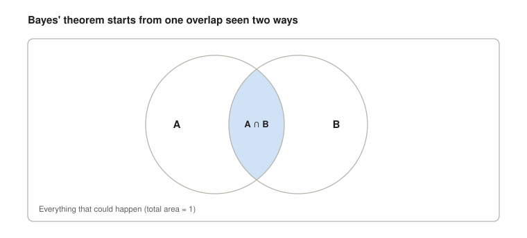
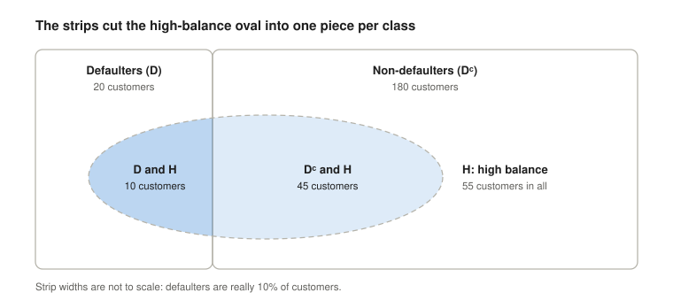
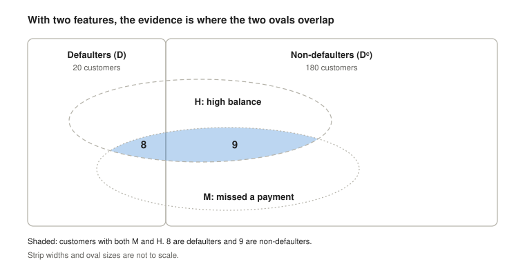
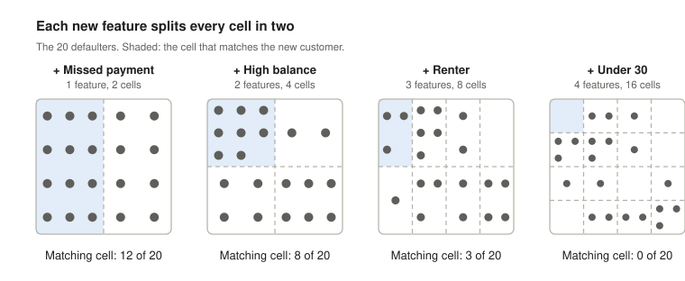
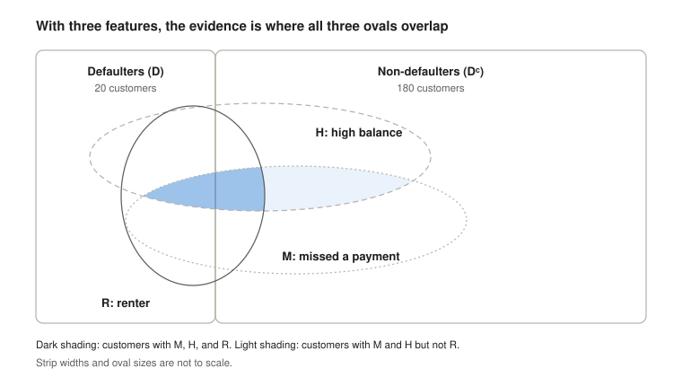
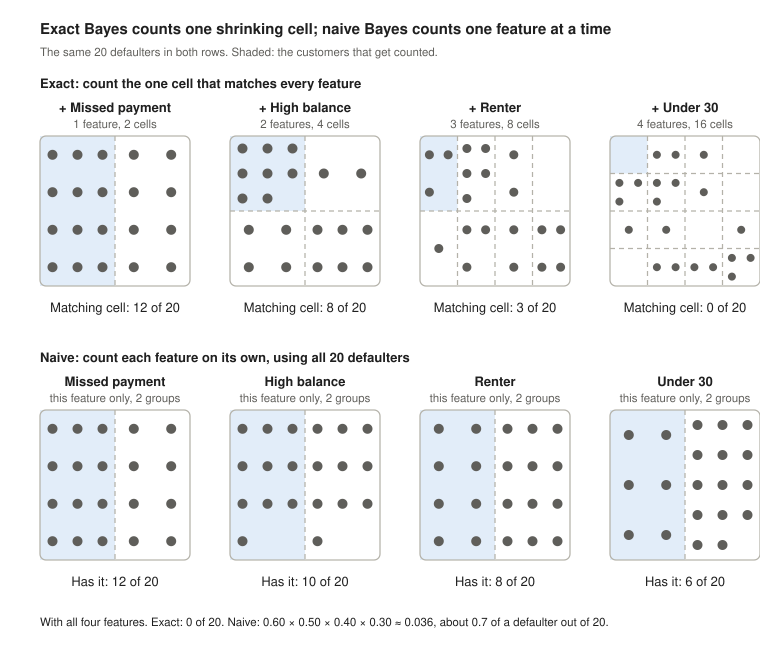
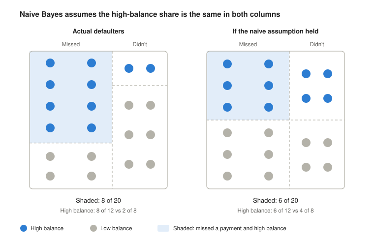
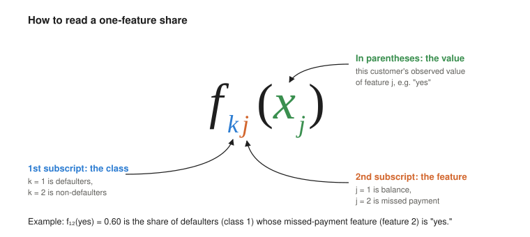

# From Bayes' Theorem to Naive Bayes

This reading builds [equation 4.30](#eq-4-30) in ISL, the naive Bayes classifier, one small step at a time, starting from a Venn diagram you've probably seen before.

[Equation 4.30](#eq-4-30) looks intimidating on the page. It isn't. Every piece of it answers a plain question about counting customers, and by the end you'll be able to read it out loud in ordinary words.

There's no calculus here. Everything is shares of a group: "what fraction of these customers have that property."

## Summary

Bayes' theorem gives the exact probability of a class given the evidence, $P(D \mid M \cap H)$, but it needs a number we can't count if there are many features: the share of a class, $P(M \cap H \mid D)$, that matches an entire feature vector, $x = \langle m^*, h^* \rangle$. Naive Bayes replaces that number with a product of one-feature shares, $P(M \cap H \mid D) \approx P(M \mid D) \times P(H \mid D)$, which are always easy to count. This assumption is usually false, but the classifier often works well anyway. (In our running example, D means "defaulted," M means "missed a payment," and H means "high balance.")

Each step below states what its section shows. If a step doesn't make sense to you yet, click it to jump to that section. Every section ends with a link back here.

1. **[Bayes' theorem from a Venn diagram](#section-1).** Writing the overlap P(A ∩ B) two ways and setting them equal gives Bayes' theorem, which turns P(A | B) into a formula that uses P(B | A).
2. **[Flipping the condition helps](#section-2).** The probability we want, P(class | evidence), is hard to estimate directly. After the flip, every piece is a share we can count in past data.
3. **[Running example](#section-3).** 200 bank customers, two classes (defaulted or not), and two yes-or-no features (high balance, missed a payment).
4. **[One feature: the denominator becomes a sum](#section-4).** The evidence splits into one piece per class, so the denominator can be written as a sum of pieces in the same form as the numerator, P(evidence | class) × P(class). That form lets one approximation later handle the top and bottom together. The posterior is one class's piece divided by the whole.
5. **[Two features: the evidence is an overlap](#section-5).** With two features, the evidence is where two regions overlap. The algebra doesn't change.
6. **[The hard part](#section-6).** The share of a class that matches every feature comes from a single cell. Each new feature doubles the number of cells, so with many features most cells hold few or no customers. A count from such a cell is unreliable, an empty one breaks the formula, and adding 1 to every cell (smoothing) only makes the model ignore the features.
7. **[The naive assumption](#section-7).** The chain rule splits the hard share into steps, each counted in a smaller group than the last. Naive Bayes assumes features are independent within each class, so each step becomes a one-feature share counted among the whole class. It trades a little bias (an assumption that's usually false) for much lower variance (every estimate uses a whole class).
8. **[Putting it together](#section-8).** For our customer, naive Bayes estimates a 40% chance of default against the true 47%. It's less accurate about the exact number, but it reaches the same conclusion.
9. **[ISL's notation](#section-9).** $\pi_k$ is the prior, $f_k(x)$ is the share of class $k$ matching the whole evidence, and $f_{kj}(x_j)$ is the share of class $k$ whose feature $j$ equals $x_j$, whatever their other features are. [Equation 4.15](#eq-4-15) is exact Bayes, and [equation 4.29](#eq-4-29) is the naive assumption.
10. **[Equation 4.30](#section-10).** Substitute [4.29](#eq-4-29) into [4.15](#eq-4-15), and you have the naive Bayes classifier.
11. **[Learning Check Practice](#section-11).** Test yourself on the key ideas. The optional [Stretch](#stretch) section after it practices them with short computations.

<strong>Summary in ISL notation</strong>

Bayes' theorem gives the exact probability of class $k$ given the evidence, $\Pr(Y = k \mid X = x)$, but it needs a number we can't count if there are many features: the share of class $k$, $f_k(x)$, that matches an entire feature vector, $x = (x_1, \ldots, x_p)$. Naive Bayes replaces that number with a product of one-feature shares, $f_k(x) \approx f_{k1}(x_1) \times f_{k2}(x_2) \times \cdots \times f_{kp}(x_p)$, which are always easy to estimate. This assumption is usually false, but the classifier often works well anyway.

1. **[Bayes' theorem from a Venn diagram](#section-1).** Writing the overlap of two events two ways gives Bayes' theorem. For classification, it turns $\Pr(Y = k \mid X = x)$ into a formula that uses $f_k(x) = \Pr(X = x \mid Y = k)$.
2. **[Why flipping the condition helps](#section-2).** The posterior $\Pr(Y = k \mid X = x)$ is hard to estimate directly. After the flip, the pieces are the prior $\pi_k$ and $f_k(x)$, both shares we can count in past data.
3. **[Our running example](#section-3).** $K = 2$ classes ($k = 1$ is defaulted, $k = 2$ is not) and $p = 2$ yes-or-no features ($X_1$ is balance, $X_2$ is missed payment), with 200 past customers.
4. **[One feature: the denominator becomes a sum](#section-4).** The evidence splits into one piece per class, so $\Pr(X = x) = \sum_{l=1}^{K} \pi_l f_l(x)$. That gives [equation 4.15](#eq-4-15), $\Pr(Y = k \mid X = x) = \dfrac{\pi_k f_k(x)}{\sum_{l=1}^{K} \pi_l f_l(x)}$. Every term, top and bottom, has the form $\pi_l f_l(x)$, so one approximation of $f_l(x)$ later handles both.
5. **[Two features: the evidence is an overlap](#section-5).** $X = x$ means every feature matches at once: $X_1 = x_1$ and $X_2 = x_2$. [Equation 4.15](#eq-4-15) doesn't change.
6. **[The hard part](#section-6).** $f_k(x)$ comes from a single cell: the customers in class $k$ with $X_1 = x_1, \ldots, X_p = x_p$. With $p$ yes-or-no features there are $2^p$ cells per class, so with many features most cells hold few or no customers. Estimating $f_k(x)$ from such a cell is unreliable, an empty one can make [equation 4.15](#eq-4-15) become 0/0, and adding 1 to every cell (smoothing) only pushes $\Pr(Y = k \mid X = x)$ back to the prior $\pi_k$.
7. **[The naive assumption](#section-7).** The chain rule splits $f_k(x)$ into factors like $\Pr(X_2 = x_2 \mid X_1 = x_1, Y = k)$, each counted in a smaller group than the last. Naive Bayes assumes the features are independent within each class, so each factor becomes a one-feature share $f_{kj}(x_j)$, counted among all of class $k$. That's [equation 4.29](#eq-4-29): $f_k(x) \approx f_{k1}(x_1) \times f_{k2}(x_2) \times \cdots \times f_{kp}(x_p)$. It trades a little bias (an assumption that's usually false) for much lower variance (every $f_{kj}$ uses a whole class).
8. **[Putting it together](#section-8).** For our customer, naive Bayes estimates $\Pr(Y = 1 \mid X = x) \approx 0.40$, against the true 0.47. It's less accurate about the exact number, but it reaches the same conclusion.
9. **[ISL's notation](#section-9).** This section defines the symbols used here: $\pi_k$ is the prior, $f_k(x)$ is the share of class $k$ matching the whole evidence, and $f_{kj}(x_j)$ is the share of class $k$ whose feature $j$ equals $x_j$. For numeric features, the $f$'s are densities.
10. **[Equation 4.30](#section-10).** Substitute [4.29](#eq-4-29) into [4.15](#eq-4-15): $\Pr(Y = k \mid X = x) \approx \dfrac{\pi_k \times f_{k1}(x_1) \times \cdots \times f_{kp}(x_p)}{\sum_{l=1}^{K} \pi_l \times f_{l1}(x_1) \times \cdots \times f_{lp}(x_p)}$. That's the naive Bayes classifier.
11. **[Learning Check Practice](#section-11).** Test yourself on the key ideas, one at a time. The optional [Stretch](#stretch) section after it practices them with short computations.

## 1. Bayes' theorem from a Venn diagram

Bayes' theorem comes from writing the overlap of two sets in two different ways and setting them equal.

In the picture below, the rectangle is everything that could happen, and its total area is 1. Circle A is one event and circle B is another. The area of any region is the probability of landing in it. So the area of A is P(A), and the area of the overlap is P(A and B), which is also written P(A ∩ B). The symbol ∩ is read "and."

*Figure 1. Two events, A and B, in a rectangle of total area 1. The shaded overlap is P(A ∩ B).*

The shaded overlap is P(A ∩ B). Everything below is about that one region, seen from inside A and from inside B.

**Conditional probability.** P(A | B) is read "the probability of A given B." It means: if you already know you're somewhere in B, what's the chance you're also in A? Once you know you're in B, the rest of the rectangle doesn't matter. B becomes your whole world, and the part of it that's also in A is the overlap. So:

$$
P(A \mid B) = \frac{P(A \cap B)}{P(B)}
$$

In words: the share of B that is also in A.

The same logic works the other way around. If you know you're in A, the share of A that's also in B is:

$$
P(B \mid A) = \frac{P(A \cap B)}{P(A)}
$$

**Two ways to write the overlap.** Multiply each equation by its denominator and you get two expressions for the same overlap:

$$
P(A \cap B) = P(A \mid B)\,P(B) \qquad\text{and}\qquad P(A \cap B) = P(B \mid A)\,P(A)
$$

Both equal the same area, so they equal each other:

$$
P(A \mid B)\,P(B) = P(B \mid A)\,P(A)
$$

Divide both sides by P(B), and you have **Bayes' theorem**:

$$
P(A \mid B) = \frac{P(B \mid A)\,P(A)}{P(B)}
$$

Notice what happened. We started with a question about A given B and ended with an answer that uses B given A instead. The condition got flipped. That flip is the whole reason Bayes' theorem is useful, as the next section shows.

**Names for the pieces.** Each piece of Bayes' theorem has a name. The names make the most sense if you think of A as something we want to know about and B as something we've observed: the evidence.

$$
\underbrace{P(A \mid B)}_{\text{posterior}} = \frac{\underbrace{P(B \mid A)}_{\text{likelihood}}\;\underbrace{P(A)}_{\text{prior}}}{\underbrace{P(B)}_{\text{evidence}}}
$$

| Piece | Name | What it means |
| --- | --- | --- |
| P(A) | **Prior** | How probable A is *before* we know anything about B. |
| P(A \| B) | **Posterior** | How probable A is *after* we learn that B happened. |
| P(B \| A) | **Likelihood** | How probable the evidence B is when A is true. |
| P(B) | **Evidence** | How probable the evidence B is overall. |

"Prior" and "posterior" are Latin for "before" and "after." Bayes' theorem is a rule for updating: it starts with the prior and turns it into the posterior by multiplying by P(B | A) / P(B). That ratio compares how common the evidence is when A is true to how common it is overall. If B is more common when A is true, the ratio is bigger than 1, and seeing B makes A more probable.

### Practice Questions

1. P(A | B) and P(B | A) both have the shaded overlap ( Fig 1 ) in the numerator. Why are they usually different numbers?

Answer

They divide the same overlap by different regions. P(A | B) divides it by the area of B, and P(B | A) divides it by the area of A. They're equal only when A and B have the same area, that is, when P(A) = P(B).

2. Bayes' theorem comes from writing P(A ∩ B) two ways. What are the two ways, and what does setting them equal let us do?

Answer

P(A ∩ B) = P(A | B) P(B) and P(A ∩ B) = P(B | A) P(A). Setting them equal and dividing by P(B) gives P(A | B) in terms of P(B | A). That flips the condition: a question about A given B gets answered using B given A.

3. Name each of the four pieces of Bayes' theorem. Which two are "before" and "after" answers to the same question about A, and what turns one into the other?

Answer

P(A | B) is the posterior, P(B | A) is the likelihood, P(A) is the prior, and P(B) is the evidence. The prior and the posterior both answer the question "how probable is A?", but at different times, so they're usually different numbers. The prior, P(A), is the answer before we know whether B happened. The posterior, P(A | B), is the answer after we learn that it did. Multiplying the prior by the ratio P(B | A) / P(B) turns it into the posterior. When B is more common if A is true than it is overall, that ratio is bigger than 1, and the posterior is bigger than the prior.

[↑ Back to summary](#summary)

## 2. Why flipping the condition helps with classification

Bayes' theorem lets us answer the question we care about using quantities we can actually count in training data.

In classification, the question is always some version of: "Given what we know about this customer, how likely is each outcome?" For a bank, that might be the probability a customer will default given their account details. Written as a conditional probability:

$$
P(\text{default} \mid \text{what we know about the customer})
$$

This is the **posterior** from Section 1: the probability of a class *after* seeing the evidence. It's hard to estimate directly. Bayes' theorem flips it:

$$
P(\text{default} \mid \text{evidence}) = \frac{P(\text{evidence} \mid \text{default})\;P(\text{default})}{P(\text{evidence})}
$$

Now look at each piece and ask how you'd get it from a spreadsheet of past customers whose outcomes you already know.

| Piece | In words | How hard to estimate? |
| --- | --- | --- |
| P(default) | The **prior**: the share of all customers who defaulted. | Easy: count the defaulters and divide by the total. |
| P(evidence \| default) | The **likelihood**: among defaulters only, the share who look like this customer. | Easy when the evidence is one simple fact. Hard when it's many facts at once (Section 6). |
| P(evidence) | The **evidence**: among *all* customers, the share who look like this customer. | Easy for one fact. Hard for many, so we'll rewrite it (Section 4). |

The middle row is the key change. Instead of asking "what will this customer do?", we ask "what did past defaulters look like?" That's a question about data we already have.

Two questions remain, and the rest of this reading answers them:

1. What should we do with the denominator, P(evidence)?
2. A real customer isn't described by one fact. They have a balance, a payment history, an income, and more. How do we use evidence made of many features at once?

### Practice Questions

1. Name the three pieces on the right side of Bayes' theorem for classification, and say in words what each one asks of past data.

Answer

P(default) is the **prior**. It asks: what share of all past customers defaulted? P(evidence | default) is the **likelihood**. It asks: among past defaulters, what share looked like this customer? P(evidence) is the **evidence**. It asks: among all past customers, what share looked[*: the answer we compute from the other three.

2. Which pieces does the table in this section call hard, and what makes them hard?

Answer

P(evidence | default) and P(evidence). Both are easy when the evidence is one simple fact, and both get hard when the evidence is many facts at once, because few past customers match all of them.

[↑ Back to summary](#summary)

## 3. Our running example

We'll use a small, invented bank with 200 past customers, two possible outcomes, and two facts about each customer.

**Customer.** One person the bank has records on: one row of the data. Each customer has a known outcome and known feature values.

**Class.** The outcome we want to predict. Every customer is in exactly one class:

- **D**: customers who defaulted.
- **Dᶜ**: customers who did not default.

The little c stands for **complement**. The complement of a set is everything outside it, so Dᶜ is read "not D." A set and its complement never overlap, and together they cover everyone. Every customer is in D or in Dᶜ, never both.

**Features.** Facts we know about a customer. ISL also calls them **predictors**. We'll use two, each with a yes-or-no answer:

- **H**: the customer has a high balance. **Hᶜ** means they don't.
- **M**: the customer missed a payment last month. **Mᶜ** means they didn't.

**Evidence.** The feature values we observe for a new customer, the one we're trying to classify. For example, "this customer has a high balance" is evidence H. "This customer has a high balance and missed a payment" is the evidence M ∩ H.

Here are the counts. These numbers are made up so the arithmetic stays simple.

|  | Defaulters (D) | Non-defaulters (Dᶜ) | Everyone |
| --- | --- | --- | --- |
| Customers | 20 | 180 | 200 |
| High balance (H) | 10 | 45 | 55 |
| Missed a payment (M) | 12 | 36 | 48 |
| Both M and H | 8 | 9 | 17 |

A few shares we'll use again:

- P(D) = 20/200 = 0.10, and P(Dᶜ) = 180/200 = 0.90. Defaulters are rare.
- Among defaulters: P(H | D) = 10/20 = 0.50, and P(M | D) = 12/20 = 0.60.
- Among non-defaulters: P(H | Dᶜ) = 45/180 = 0.25, and P(M | Dᶜ) = 36/180 = 0.20.

### Practice Questions

1. Every customer is in exactly one of D or Dᶜ. Why will that matter when we start adding up pieces of the evidence?

Answer

Because D and Dᶜ never overlap and together cover everyone, splitting a group of customers by class counts each customer exactly once. That's what lets us add the per-class pieces to get the whole group, which Section 4 calls the law of total probability.

2. P(H | D) = 0.50 and P(H | Dᶜ) = 0.25. What does that comparison suggest about a high balance as evidence?

Answer

A high balance is twice as common among defaulters as among non-defaulters, so seeing it should push a customer's estimated risk up. How far it pushes also depends on how rare defaulters are to begin with, which Section 4 shows.

[↑ Back to summary](#summary)

## 4. One feature: the denominator becomes a sum

With one feature, the denominator of Bayes' theorem can be rewritten as a sum of terms that look just like the numerator.

Suppose a new customer has a high balance. Our evidence is H. Plug D and H into Bayes' theorem in place of A and B:

$$
P(D \mid H) = \frac{P(H \mid D)\,P(D)}{P(H)}
$$

**Why rewrite the denominator?** Right now, P(H) is easy: 55 of the 200 customers have a high balance. But real customers are described by many features, and then the evidence is the overlap of all of them. The denominator becomes P(H ∩ M ∩ R ∩ ⋯), the share of *all* customers who match every feature at once. As Section 6 will show, there's no obvious way to estimate a share like that.

The numerator has a different form: P(evidence | class) × P(class). If we rewrite the denominator in that same form, one term per class, then the top and bottom are built from the same kind of piece. Later, that lets us make a single approximation, the "naive" assumption in Section 7, and use it on every piece of the form P(evidence | class) × P(class), in the numerator and the denominator at once. Without the rewrite, the denominator would still be a share of everyone, and the approximation would have nothing to work on.

Here's the rewrite:

$$
P(H) = P(H \mid D)\,P(D) + P(H \mid D^c)\,P(D^c)
$$

With exact numbers, both forms give the same value. The rewrite changes the form, not the answer.

**The picture.** Here's why that equation is true. Draw the 200 customers as a rectangle and cut it into two vertical **strips**: defaulters on the left, non-defaulters on the right. Every customer is in exactly one strip. Then draw the evidence, the high-balance customers, as an oval on top (Figure 2).

*Figure 2. The 200 customers cut into class strips, with the high-balance customers drawn as an oval. The strips cut the oval into a defaulter piece and a non-defaulter piece.*

The oval crosses the boundary between the strips, so the strips cut it into two pieces that don't overlap. The whole oval is P(H). Each piece is one term of the sum:

- The left piece is the customers in D *and* H. Its share is P(H | D) × P(D): half of the defaulters, who are a tenth of everyone. That's 10 customers.
- The right piece is the customers in Dᶜ *and* H. Its share is P(H | Dᶜ) × P(Dᶜ): a quarter of the non-defaulters, who are nine tenths of everyone. That's 45 customers.

Adding up the pieces of a split set like this is called the **law of total probability**.

<strong>Another approach: the posteriors must add to 1</strong>

This customer either defaults or doesn't, so the two posterior probabilities have to add up to 1:

$$
P(D \mid H) + P(D^c \mid H) = 1
$$

We can use this fact to derive the same result we reasoned our way to above. Write out both with Bayes' theorem:

$$
\frac{P(H \mid D)\,P(D)}{P(H)} + \frac{P(H \mid D^c)\,P(D^c)}{P(H)} = 1
$$

They share the same denominator. The only way two fractions with the same bottom can add to 1 is if the bottom equals the sum of the tops:

$$
P(H) = P(H \mid D)\,P(D) + P(H \mid D^c)\,P(D^c)
$$

The same reasoning works in reverse: a denominator built as the sum of the numerators always makes the posteriors add to exactly 1. That stays true even after we approximate the pieces in Section 7, which is why the aside in Section 8 matters.

Putting the sum into Bayes' theorem gives:

$$
P(D \mid H) = \frac{P(H \mid D)\,P(D)}{P(H \mid D)\,P(D) + P(H \mid D^c)\,P(D^c)}
$$

Notice that the numerator is one of the two terms in the denominator. The posterior is "the defaulter piece of the oval divided by the whole oval." With our numbers:

$$
P(D \mid H) = \frac{0.50 \times 0.10}{0.50 \times 0.10 + 0.25 \times 0.90} = \frac{0.05}{0.05 + 0.225} = \frac{0.05}{0.275} \approx 0.18
$$

Check it by counting: 55 customers have a high balance, and 10 of them defaulted. 10/55 ≈ 0.18. A high balance raises this customer's chance of default from 10% to about 18%.

### Practice Questions

1. In Figure 2, which region is the numerator of P(D | H), and which is the denominator? Why is P(D | H) only about 0.18, even though a high balance is twice as common among defaulters?

Answer

The numerator is the defaulter piece of the oval (10 customers), and the denominator is the whole oval (55 customers). The posterior is low because defaulters are rare: the non-defaulter strip is nine times wider, so even though a smaller share of non-defaulters have a high balance, they still make up 45 of the 55 customers in the oval.

2. With one feature, P(H) is easy to count directly. Why does this section rewrite it as a sum anyway?

Answer

Because with many features, the denominator becomes the share of everyone matching every feature at once, which there's no obvious way to estimate. Writing it per class puts it in the same form as the numerator, P(evidence | class) × P(class). Then one approximation, the naive assumption in Section 7, can handle the top and bottom together. With exact numbers, both forms give the same value.

[↑ Back to summary](#summary)

## 5. Two features: the evidence is an overlap

When the evidence is two facts at once, it's the overlap of two ovals, and Bayes' theorem works exactly as before with that overlap in place of the single oval.

Suppose our new customer has a high balance *and* missed a payment. Each fact picks out its own group of customers, so we draw two ovals on the strips (Figure 3): H for high balance and M for missed a payment. The customers who match *both* facts are in the region where the ovals overlap, M ∩ H. That overlap is our evidence now.

*Figure 3. Two feature ovals. The evidence, M ∩ H, is their overlap, and the strips cut it in two.*

A dot in the picture is a whole customer, with every feature value they have. A dot inside the H oval has a high balance. A dot inside both ovals has a high balance and missed a payment. Each oval is one fact; the overlap is the combination we observed.

Everything from Section 4 carries over. Replace the single event H with the overlap M ∩ H:

$$
P(D \mid M \cap H) = \frac{P(M \cap H \mid D)\,P(D)}{P(M \cap H \mid D)\,P(D) + P(M \cap H \mid D^c)\,P(D^c)}
$$

The strips cut the overlap into two pieces, one per class. From the table in Section 3, 8 of the 20 defaulters have both features and 9 of the 180 non-defaulters do:

$$
P(D \mid M \cap H) = \frac{\frac{8}{20} \times 0.10}{\frac{8}{20} \times 0.10 + \frac{9}{180} \times 0.90} = \frac{0.04}{0.04 + 0.045} \approx 0.47
$$

Check it by counting: 17 customers have both features, and 8 of them defaulted. 8/17 ≈ 0.47. The two facts together push this customer's risk from 10% to nearly half.

Nothing new happened in the algebra. A feature vector just makes the evidence a smaller region: the overlap of one region per feature. With $p$ features, the evidence is where all $p$ regions overlap.

### Practice Questions

1. In Figure 3, what happens to the evidence region when a second feature is added? Why doesn't the algebra change?

Answer

The evidence shrinks from one oval to the overlap of two ovals. It's still a single region, and the strips still cut it into one piece per class, so Bayes' theorem has exactly the same shape. Only the name of the evidence changes, from H to M ∩ H.

2. Adding the missed-payment fact moved the posterior from about 0.18 to about 0.47. Using the pieces in Figures 2 and 3, explain why.

Answer

The defaulter piece barely shrank, from 10 customers to 8, but the non-defaulter piece shrank a lot, from 45 to 9. So defaulters make up a much larger share of the new evidence region: 8 of 17 instead of 10 of 55.

[↑ Back to summary](#summary)

## 6. The hard part: the share with every feature at once

The pieces that get hard are the shares of each class that match every feature in the evidence at once. With many features, there aren't enough customers to count them.

Here's the equation from Section 5 again, with those pieces marked:

$$
P(D \mid M \cap H) = \frac{\underbrace{P(M \cap H \mid D)}_{\text{hard}}\,P(D)}{\underbrace{P(M \cap H \mid D)}_{\text{hard}}\,P(D) + \underbrace{P(M \cap H \mid D^c)}_{\text{hard}}\,P(D^c)}
$$

The marked pieces are all the same kind of quantity: among the customers in one class, the share who match *every* fact in the evidence. The priors, P(D) and P(Dᶜ), are easy: count the class and divide by the total.

**What we counted in Section 5.** We got the marked pieces by reading the "Both M and H" row of the table: 8 of the 20 defaulters and 9 of the 180 non-defaulters have both features. That row is exactly what we won't be able to count once customers are described by many features. To see why, look at how a class gets divided up.

**Each class splits into cells.** Every defaulter either missed a payment or didn't, and either has a high balance or doesn't. That makes four possible combinations of answers. Call each combination a **cell**. Here are our 20 defaulters sorted into their four cells:

| Defaulters | High balance (H) | Not high (Hᶜ) |
| --- | --- | --- |
| Missed a payment (M) | **8** | 4 |
| Didn't miss (Mᶜ) | 2 | 6 |

Our new customer missed a payment and has a high balance, so their evidence matches exactly one cell: the bold one. The marked piece P(M ∩ H | D) is that cell's count divided by the number of defaulters: 8/20 = 0.40. The non-defaulters have their own four cells, and P(M ∩ H | Dᶜ) comes from their matching cell: 9/180 = 0.05.

So counting the marked pieces means this: in each class, find the one cell that matches the new customer, and count the customers in it.

**Every new feature splits every cell.** Add a third yes-or-no feature and each of the four cells splits in two, making eight. Add a fourth and there are sixteen. Figure 4 follows our 20 defaulters as features are added. The first two features are the real ones from our table. The third and fourth, "is a renter" and "is under 30," are made up for this picture only. In each panel, the shaded cell is the one that matches the new customer.

*Figure 4. The 20 defaulters spread over 2, 4, 8, and 16 cells as features are added. In each panel, the shaded cell matches the new customer.*

The matching cell shrinks from 12 defaulters to 8, then 3, then none. With four features, our data says no defaulter has ever looked like this customer, so the marked piece for the defaulters would be 0/20. That's almost certainly wrong. It's just that 20 customers probably won't fill 16 cells.

Real datasets have more customers than ours, but they also have more features. With $p$ yes-or-no features, each class splits into $2^p$ cells. ISL's Default dataset has 10,000 customers: 333 defaulters and 9,667 non-defaulters. Here's how many customers an average cell would hold if they were spread evenly:

| Yes-or-no features | Cells per class | Defaulters per cell (333 total) | Non-defaulters per cell (9,667 total) |
| --- | --- | --- | --- |
| 2 | 4 | about 83 | about 2,400 |
| 5 | 32 | about 10 | about 300 |
| 10 | 1,024 | about 0.3 | about 9 |
| 20 | 1,048,576 | about 0.0003 | about 0.009 |

Real customers aren't spread evenly, but the averages tell the story. By nine features, the average defaulter cell holds less than one customer.

**What goes wrong in the equation.** With 20 features, the new customer's cell is almost certainly empty in both classes. Put those counts into the marked pieces and every one of them is 0:

$$
P(D \mid \text{evidence}) = \frac{0 \times P(D)}{0 \times P(D) + 0 \times P(D^c)} = \frac{0}{0}
$$

The formula gives no answer at all. It isn't much better when only one cell is empty. If the defaulter cell is empty and the non-defaulter cell isn't, the posterior comes out as exactly 0: the model claims this customer cannot possibly default. If the defaulter cell holds a single past customer and the non-defaulter cell is empty, the posterior comes out as exactly 1. Neither answer is believable, and both come from cells with almost no one in them.

**Can't we just add 1 to every cell?** That's a real technique, called **Laplace smoothing** or add-one smoothing: add 1 to every cell's count before dividing, so no share is ever exactly 0. It gets rid of the 0/0, but it doesn't add any information. With 20 features, nearly every cell is empty, so after smoothing nearly every cell gets the same tiny share. The bottom of each fraction grows by 1,048,576 because every cell got one extra customer:

- Defaulters: (0 + 1) / (333 + 1,048,576) ≈ 0.00000095
- Non-defaulters: (0 + 1) / (9,667 + 1,048,576) ≈ 0.00000094

Those two shares are almost equal, so they nearly cancel in Bayes' theorem, and the posterior comes out at about 3.4%. That's just the prior: 333 of 10,000 customers defaulted. The formula works again, but it ignores every feature. A combination that's typical for defaulters and one that's bizarre for them get the same answer.

**The real problem: small cells can't be trusted.** Empty cells are the most visible symptom, but cells with one or two customers are nearly as bad. After smoothing, a cell holding one past defaulter gets twice the share of an empty cell, based on a single person. Whether that person landed in this cell or a neighboring one is mostly luck, so the estimate reflects which few customers happened to be in the data, not what's typical for the class. Statisticians call this **high variance**: collect a different 10,000 customers and the cell estimates would change wildly. With $2^p$ cells per class, almost every estimate rests on almost no data.

**Numeric features make it worse.** A dollar balance isn't yes-or-no. It can take thousands of values, so by itself it splits each class into thousands of cells, and no two customers share an exact balance. Even one or two numeric features leave almost every cell empty.

In our small table, every cell has customers in it to count, so the problem is invisible. It shows up as soon as the data has more than a handful of features.

The equation itself is fine. The trouble is the marked pieces: each one comes from a single cell, and with many features that cell holds too few customers to give a trustworthy estimate, or none at all. The next section breaks the marked piece into steps, shows where the trouble comes from, and makes an assumption that gets around it.

### Practice Questions

1. In Figure 4, the matching cell shrinks from 12 to 8 to 3 to 0 defaulters. Why does each feature shrink it, and what's wrong with estimating the defaulters' share as 0/20 in the last panel?

Answer

Each new feature splits every cell in two, and the matching cell keeps only the customers who also match the new feature. A count of 0 claims no defaulter could ever look like this customer, but it really just means 20 customers can't fill 16 cells. An estimate built from almost no data mostly reflects luck. That's high variance.

2. A classmate suggests adding 1 to every cell. What problem does that fix, and what problem remains?

Answer

It removes the zeros, so the formula never gives 0/0 or an exact 0 or 1. But with many features, nearly every cell is empty, so after smoothing nearly every cell gets the same tiny share. Those shares cancel in Bayes' theorem, and the posterior falls back to the prior, ignoring the features. Small cells are still unreliable.

[↑ Back to summary](#summary)

## 7. The naive assumption

Naive Bayes gets around the hard part by assuming that, within each class, knowing one feature tells you nothing more about any other.

**A third feature.** To see how the hard piece is built, add one more fact about our new customer: they rent their home. This is the renter feature, R, from Figure 4 in Section 6. The evidence is now where three ovals overlap (Figure 5):

*Figure 5. Three feature ovals. The evidence, M ∩ H ∩ R, is the smaller region where all three overlap.*

The evidence region got smaller. Of the customers who missed a payment and have a high balance, only the renters are left. The strips still cut that region into one piece per class, so Bayes' theorem has the same shape as in Section 5, with M ∩ H ∩ R in place of M ∩ H:

$$
P(D \mid M \cap H \cap R) = \frac{\underbrace{P(M \cap H \cap R \mid D)}_{\text{hard}}\,P(D)}{\underbrace{P(M \cap H \cap R \mid D)}_{\text{hard}}\,P(D) + \underbrace{P(M \cap H \cap R \mid D^c)}_{\text{hard}}\,P(D^c)}
$$

The hard pieces are the same kind of quantity as in Section 6: the share of a class that matches every fact in the evidence at once. Now there's one more fact to match.

**The chain rule.** A general rule of probability breaks a share like this into steps. It's called the **chain rule**. For any three events A, B, and C:

$$
P(A \cap B \cap C) = P(A) \times P(B \mid A) \times P(C \mid A \cap B)
$$

In words: to find the share in all three, take the share in A, then the share of *those* that are also in B, then the share of *those* that are also in C. Proving it is beyond the scope of this reading. It works for any number of events, with one more factor for each event, and it makes no assumptions.

The chain rule also works inside a single class. Add "| D" to every piece, which just means we're only looking at defaulters:

$$
P(M \cap H \cap R \mid D) = P(M \mid D) \times P(H \mid M \cap D) \times P(R \mid M \cap H \cap D)
$$

**Checking it by counting.** Here's Figure 4 from Section 6 again. Each panel adds one feature, and the shaded cell is the one that matches our customer:

*Figure 4 (repeated from Section 6).*

Each factor of the chain rule is one panel's matching cell divided by the previous panel's. Using the first three panels:

$$
P(M \cap H \cap R \mid D) = \underbrace{\frac{12}{20}}_{P(M \mid D)} \times \underbrace{\frac{8}{12}}_{P(H \mid M \cap D)} \times \underbrace{\frac{3}{8}}_{P(R \mid M \cap H \cap D)} = \frac{3}{20}
$$

The 12s and 8s cancel, leaving the 3 of 20 defaulters in the matching cell. The chain rule just counts the matching cell in steps: start with all the defaulters, then keep only those who match the first feature, then the second, then the third.

Read the second factor carefully. P(H | M ∩ D) = 8/12 = 2/3 is the high-balance share among customers who are defaulters *and* missed a payment. It isn't the high-balance share among all defaulters, which is 10/20 = 1/2. For our defaulters, knowing that someone missed a payment changes how likely they are to have a high balance. One feature carries information about the other.

**Where the difficulty shows up.** Look at the group each factor is counted in, which is everything to the right of the bar:

- P(M | D) is counted among all 20 defaulters.
- P(H | M ∩ D) is counted among the 12 defaulters who missed a payment.
- P(R | M ∩ H ∩ D) is counted among the 8 defaulters who missed a payment and have a high balance.

Each new feature adds a factor, and each factor is counted inside a group defined by all the features before it. The intersections to the right of the bar keep piling up, and the groups shrink into the cells from Section 6. Add the fourth feature from Figure 4 and the next factor, P(under 30 | M ∩ H ∩ R ∩ D), would be counted among just 3 defaulters, and none of them are under 30. With 20 features, the last factor would be counted among the defaulters who match 19 other features, which is usually nobody.

The chain rule doesn't create this problem. The product always equals the share in the one matching cell, so it's exactly as hard as counting that cell. What the chain rule does is show where the problem lives: in the piled-up conditions to the right of each bar. That's exactly where naive Bayes makes its assumption.

**The assumption.** Naive Bayes drops those extra conditions. In each factor of the chain rule, it replaces the shrinking group with the whole class:

$$
\begin{aligned}
P(M \cap H \cap R \mid D) &= P(M \mid D) \times P(H \mid M \cap D) \times P(R \mid M \cap H \cap D) \\
&\overset{\text{naive}}{\approx} P(M \mid D) \times P(H \mid D) \times P(R \mid D)
\end{aligned}
$$

Two factors changed: P(H | M ∩ D) became P(H | D), and P(R | M ∩ H ∩ D) became P(R | D). In words: among defaulters, the high-balance share is assumed to be the same whether or not someone missed a payment, and the renter share is assumed to be the same no matter which of those two features someone has. This is called **independence within the class**, or **conditional independence**. It's a choice we make, not a fact about the data, so it gets ≈ instead of =. From here on, ≈ marks any formula that relies on this assumption. An = means the formula is always true.

With only our two real features, the same assumption gives:

$$
P(M \cap H \mid D) \overset{\text{naive}}{\approx} P(M \mid D) \times P(H \mid D)
$$

That's the version the two-feature square of defaulters below, and Section 8, use.

Each factor on the right involves only one feature and one class. Groups like "defaulters who missed a payment" split a class by one feature only, so they stay big no matter how many features there are. Each factor is easy to estimate by counting.

**Why this fixes the small cells.** Go back to all four features from Figure 4 in Section 6, and call the fourth one, "is under 30," Y. The exact share is the count in the one cell that matches every feature, and with four features that cell was empty. The naive share uses four one-feature shares instead, and each one is counted among all 20 defaulters (Figure 6):

*Figure 6. The same 20 defaulters counted two ways: exact counting of the one matching cell (top) and naive counting of one feature at a time (bottom).*

$$
P(M \cap H \cap R \cap Y \mid D) \overset{\text{naive}}{\approx} \frac{12}{20} \times \frac{10}{20} \times \frac{8}{20} \times \frac{6}{20} = 0.60 \times 0.50 \times 0.40 \times 0.30 = 0.036
$$

**The exact count said no defaulter has ever looked like this customer. The naive estimate says about 3.6% of defaulters would**, roughly 0.7 of a defaulter out of 20. That's a rare combination but not an impossible one, which is a much more believable answer.

Each problem from Section 6 goes away for the same reason: naive Bayes never needs a group defined by more than one feature.

- **The groups stay big, so the estimates are trustworthy.** Each factor is counted in a group split by one feature only. With ISL's 333 defaulters, every factor is counted among all 333, whether there are 2 features or 20. A different sample of customers would give nearly the same shares.
- **No more 0/0.** A product of shares from big groups is rarely zero, so the pieces of the denominator are real numbers and the posterior lands between 0 and 1 instead of at an extreme. (A zero can still happen if some feature value never appears in a class at all. Naive Bayes handles that with the add-one smoothing from Section 6. Here it's harmless: each one-feature share already rests on a whole class, so one extra customer barely moves it.)
- **Far fewer numbers to estimate.** The exact version needs a count for each of the $2^p$ cells in each class: over a million with 20 features. The naive version needs one share per feature in each class: 20.
- **Numeric features become manageable.** Instead of needing past customers with the exact same combination of numbers, naive Bayes handles each numeric feature on its own, one class at a time. Section 9 shows how.

**What the assumption costs.** The assumption fixes the small cells, but it isn't free. Back to our two real features: Figure 7 shows only the 20 defaulters, sorted two ways. The left column of each square holds the defaulters who missed a payment and the right column holds those who didn't. Blue dots have a high balance and gray dots don't. The shaded cell holds the defaulters who match the evidence: missed a payment *and* high balance.

Every dot in the whole diagram is a **defaulter**:

*Figure 7. The 20 defaulters sorted by missed payment (columns) and balance (color): our actual data (left) and what the naive assumption pretends (right).*

The left square is our actual data. In the missed column, 8 of 12 dots are blue. In the other column, only 2 of 8 are. Missing a payment really does tell you something about balance, so the assumption is false for our defaulters. The shaded cell holds 8 of 20.

The right square is what the defaulters would look like if the assumption were true. The blue share is the same in both columns: 6 of 12 and 4 of 8, both one half, which is the high-balance share among all defaulters. The shaded cell holds 6 of 20, exactly the naive product: 12/20 × 10/20 = 0.30. Naive Bayes never builds this square, and it doesn't change the data. It only multiplies the two real one-feature shares, and the right square is a picture of what that multiplication pretends.

The gap between 8 of 20 and 6 of 20 is the bias the assumption introduces. Treating features as unrelated when they aren't is why the assumption is called "naive."

**The trade-off has a name.** Counting cells makes no assumption about how the features relate, so its estimates aren't biased, but they have high variance: they rest on a handful of customers each. Naive Bayes makes an assumption that's usually false, which adds **bias**, but every estimate uses a whole class, so its variance is low. ISL calls this the **bias–variance trade-off** (Chapter 2), and it's the reason ISL gives for why naive Bayes works well in practice: a little bias is a good price for a big drop in variance. Section 8 shows how much that bias moves our customer's answer.

### Practice Questions

1. In the chain rule P(M | D) × P(H | M ∩ D) × P(R | M ∩ H ∩ D), which factor is counted in the smallest group? What does the naive assumption replace it with?

Answer

P(R | M ∩ H ∩ D), which is counted among only the 8 defaulters who missed a payment and have a high balance (the second panel of Figure 4). The naive assumption replaces it with P(R | D), counted among all 20 defaulters.

2. In Figure 7, the shaded cell holds 8 of 20 defaulters on the left and 6 of 20 on the right. Which number does naive Bayes use, and what does the difference represent?

Answer

Naive Bayes uses 6 of 20, because it multiplies P(M | D) × P(H | D) = 0.60 × 0.50 = 0.30. The gap between 8 and 6 is the bias from the assumption: in our data, defaulters who missed a payment are more likely to have a high balance, and the assumption ignores that.

3. Using Figure 6, explain why the naive estimate (0.036) is more believable than the exact count (0 of 20), even though the naive assumption is false.

Answer

The exact count rests on one empty cell, so it has high variance. Each naive factor is counted among all 20 defaulters, so it has low variance. Naive Bayes accepts a little bias in exchange for a big drop in variance. That's the bias–variance trade-off.

[↑ Back to summary](#summary)

## 8. Putting it together

With the naive assumption, our customer's probability of default comes out to 40%, close to the true 47%, using only one-feature shares.

Start from the exact version of Bayes' theorem from Section 5, with the hard pieces marked:

$$
P(D \mid M \cap H) = \frac{\underbrace{P(M \cap H \mid D)}_{\text{hard}}\,P(D)}{\underbrace{P(M \cap H \mid D)}_{\text{hard}}\,P(D) + \underbrace{P(M \cap H \mid D^c)}_{\text{hard}}\,P(D^c)}
$$

Apply the assumption in both classes, in the numerator and in each term of the denominator. Each hard piece becomes a product of one-feature shares: P(M ∩ H | D) becomes P(M | D) P(H | D), and P(M ∩ H | Dᶜ) becomes P(M | Dᶜ) P(H | Dᶜ):

$$
P(D \mid M \cap H) \approx \frac{P(M \mid D)\,P(H \mid D)\,P(D)}{P(M \mid D)\,P(H \mid D)\,P(D) + P(M \mid D^c)\,P(H \mid D^c)\,P(D^c)}
$$

Every share on the right is one feature within one class, or a prior. All of them are in the list at the end of Section 3:

$$
P(D \mid M \cap H) \approx \frac{0.60 \times 0.50 \times 0.10}{0.60 \times 0.50 \times 0.10 + 0.20 \times 0.25 \times 0.90} = \frac{0.03}{0.03 + 0.045} = 0.40
$$

Compare this to the exact answer from Section 5, which was 8/17 ≈ 0.47. The naive answer is lower because it underestimates the defaulter piece: 6 of 20 instead of the actual 8 of 20. (For the non-defaulters in our made-up data, the assumption happens to hold exactly: 9 of the 36 who missed a payment have a high balance, the same quarter as all non-defaulters. So that piece is unchanged.)

Is 40% good enough? For deciding whether this customer is high-risk, yes. Both answers say this customer is four to five times as likely to default as an average customer. Naive Bayes is often less accurate about the exact probability but still good at telling the classes apart.

**Aside: why not just estimate the denominator directly?** You might wonder why we bother rewriting P(M ∩ H) as a sum. Suppose you estimated it some other way instead, say by multiplying the overall shares of each feature: 48/200 × 55/200 = 0.066. Then the two posteriors would be 0.03/0.066 ≈ 0.45 and 0.045/0.066 ≈ 0.68. Together that's 113%, which is impossible. Building the denominator as the sum of the numerators, as in Section 4, makes the probabilities add to exactly 1 every time.

### Practice Questions

1. Naive Bayes gives 0.40 for our customer, and the exact answer is 0.47. Why is the naive answer lower, and why might the difference not matter?

Answer

The naive assumption underestimates the defaulter piece (6 of 20 instead of 8 of 20), while the non-defaulter piece is unchanged. But both answers put this customer at four to five times the average risk of 0.10, so they lead to the same decision.

2. Suppose you used the naive numerators (0.03 for defaulters and 0.045 for non-defaulters) but kept the exact denominator, P(M ∩ H) = 17/200 = 0.085. What would go wrong? (Calculator OK.)

Answer

The posteriors would be 0.03/0.085 ≈ 0.35 and 0.045/0.085 ≈ 0.53, which add to only about 0.88 instead of 1. Once the numerators are approximated, the denominator has to be the sum of those same approximated numerators (0.075) for the probabilities to add to 1.

[↑ Back to summary](#summary)

## 9. Translating into ISL's notation

ISL writes exactly what we just did, but with general symbols so it works for any number of classes and features.

| ISL symbol | Meaning | In our example |
| --- | --- | --- |
| $Y$ | The class of a customer | Defaulted or not |
| $K$ | The number of classes | 2 |
| $k$ | Which class we're asking about | $k = 1$ is $D$, $k = 2$ is $D^c$ |
| $X = (X_1, \ldots, X_p)$ | The features, as a vector | $X_1$ is balance, $X_2$ is missed payment |
| $p$ | The number of features | 2 |
| $x = (x_1, \ldots, x_p)$ | The feature values we observed: the evidence | $x_1 = \text{high}$, $x_2 = \text{yes}$ |
| $\pi_k$ | The prior: share of all customers in class $k$ | $\pi_1 = 0.10$, $\pi_2 = 0.90$ |
| $f_k(x)$ | Share of class $k$ that matches the *whole* evidence vector | $f_1(x) = P(M \cap H \mid D) = 0.40$ |
| $f_{kj}(x_j)$ | Share of class $k$ whose feature $j$ equals $x_j$ | $f_{12}(x_2) = P(M \mid D) = 0.60$ |

**Equation 4.15** is Bayes' theorem with the denominator written as a sum, exactly as in Section 4:

$$
\Pr(Y = k \mid X = x) = \frac{\pi_k\, f_k(x)}{\sum_{l=1}^{K} \pi_l\, f_l(x)}
$$

Here $X = x$ means the whole feature vector matches, so the evidence is the overlap of every feature's region. Equation 4.15 makes no independence assumption. It's always true. The letter $l$ is just a counter that runs through every class in the sum, including class $k$. It needs its own letter because $k$ is already fixed as the class in the numerator.

**Equation 4.29** is the naive assumption from Section 7, written for $p$ features:

$$
f_k(x) \approx f_{k1}(x_1) \times f_{k2}(x_2) \times \cdots \times f_{kp}(x_p)
$$

ISL writes $=$ here, and in [equation 4.30](#eq-4-30) below, because it's describing what naive Bayes computes. We write $\approx$ because the product only equals the real share when the assumption holds.

How to read $f_{kj}(x_j)$: the **first** subscript is the class, the **second** is the feature, and the value in parentheses is the feature's observed value.

*Figure 8. How to read $f_{kj}(x_j)$.*

Some examples from our bank:

- $f_{11}(x_1)$ is "the share of defaulters whose balance is high." That's 0.50.
- $f_{12}(x_2)$ is "the share of defaulters who missed a payment." That's 0.60.
- $f_{21}(x_1)$ is "the share of non-defaulters whose balance is high." That's 0.25. It is *not* "feature 2 in class 1": class always comes first.
- The value in parentheses matters. $f_{12}(\text{yes}) = 0.60$, but $f_{12}(\text{no}) = 0.40$, the share of defaulters who *didn't* miss a payment. Each $f_{kj}$ is a function: give it a feature value, and it returns how common that value is in class $k$.

So for the defaulters, [4.29](#eq-4-29) says $f_1(x) \approx f_{11}(x_1) \times f_{12}(x_2) = 0.50 \times 0.60 = 0.30$. That's the shaded cell in the right-hand square of Figure 7.

**Densities.** ISL calls the $f$'s **density functions** because some features are numbers, like an exact balance in dollars. For a numeric feature, no customer matches an exact value, so a share doesn't make sense. Instead, $f_{kj}(x_j)$ measures how crowded class $k$ is near the value $x_j$. A common way to estimate it is to fit a bell curve to the feature within each class, using that class's mean and standard deviation. Another is a histogram of the feature within the class. Either way, you can read $f$ as "how typical this value is for this class," and all the multiplying and adding above works the same.

This is how naive Bayes handles the numeric-feature problem from Section 6. Fitting one curve to one feature, using every customer in the class, is easy. Fitting a curve to every combination of features at once runs into the same empty-cell problem as counting.

### Practice Questions

1. Using Figure 8, what does $f_{22}(\text{yes})$ mean in our bank, and what's its value?

Answer

Class 2 is non-defaulters, feature 2 is missed payment, and the value is "yes." So $f_{22}(\text{yes})$ is the share of non-defaulters who missed a payment: 36/180 = 0.20.

2. Which of [equation 4.15](#eq-4-15) and [equation 4.29](#eq-4-29) is always true, and which is an assumption? What's the difference between $f_k(x)$ and $f_{kj}(x_j)$?

Answer

[Equation 4.15](#eq-4-15) is always true. It's Bayes' theorem with the denominator written as a sum. [Equation 4.29](#eq-4-29) is the naive assumption, which is why this reading writes it with ≈. $f_k(x)$ is the share of class $k$ matching the whole evidence vector at once, and $f_{kj}(x_j)$ is the share of class $k$ matching one feature, whatever their other features are. 4.29 approximates the first by a product of the second.

[↑ Back to summary](#summary)

## 10. The result: equation 4.30

Plug [equation 4.29](#eq-4-29) into [equation 4.15](#eq-4-15), replacing every $f_k(x)$ with its product, and you get the naive Bayes classifier.

The replacement happens in two places: once in the numerator, and once inside every term of the sum in the denominator:

**Equation 4.30** is the naive Bayes classifier:

$$
\Pr(Y = k \mid X = x) \approx \frac{\pi_k \times f_{k1}(x_1) \times f_{k2}(x_2) \times \cdots \times f_{kp}(x_p)}{\sum_{l=1}^{K} \pi_l \times f_{l1}(x_1) \times f_{l2}(x_2) \times \cdots \times f_{lp}(x_p)}
$$

Each part of it comes from a step we've already taken:

- **The fraction** is Bayes' theorem (Section 1): it flips "class given features" into "features given class."
- **The sum in the denominator** comes from cutting the evidence region into one piece per class (Section 4). It's the same kind of term as the numerator, written once for each class, so the naive assumption applies to it too, and the class probabilities still add to 1.
- **The products** come from the naive assumption (Section 7): within each class, the share matching every feature is estimated by the product of the one-feature shares. That's why the whole equation gets ≈.

With more than two classes, nothing changes except the number of strips. Cut the customers into $K$ strips, one per class, and the evidence region is cut into $K$ pieces, one term of the sum each. The classes don't have to be a set and its complement, like $D$ and $D^c$. They just have to not overlap and to cover everyone. Our bank was the case $K = 2$.

Read it out loud for one class $k$: "Take how common class $k$ is, times how typical each of this customer's feature values is for class $k$. Do the same for every class. Naive Bayes estimates this customer's probability of being in class $k$ as class $k$'s result as a share of the total."

With our bank, $K = 2$ and $p = 2$, so [equation 4.30](#eq-4-30) is exactly the calculation from Section 8:

$$
\Pr(Y = 1 \mid X = x) \approx \frac{0.10 \times 0.50 \times 0.60}{0.10 \times 0.50 \times 0.60 \;+\; 0.90 \times 0.25 \times 0.20} = 0.40
$$

That's the naive estimate. The true value, from counting in Section 5, is 8/17 ≈ 0.47.

One practical note. For a given customer, the denominator is the same for every class. So if you only need to know which class is most likely, and not the exact probability, you can compare the numerators and skip the denominator entirely.

### Practice Questions

1. Which part of [equation 4.30](#eq-4-30) comes from each of these: Bayes' theorem, writing the denominator as a sum, and the naive assumption?

Answer

Bayes' theorem gives the fraction: prior times share on top, divided by the probability of the evidence. Writing the denominator as a sum gives the $\sum_{l=1}^{K}$, one term per class in the same form as the numerator. The naive assumption gives the products $f_{k1}(x_1) \times \cdots \times f_{kp}(x_p)$ in place of $f_k(x)$.

2. For our customer, the numerators are 0.03 for defaulters and 0.045 for non-defaulters. If naive Bayes simply picks the most likely class, which does it pick? Does that make this customer low risk?

Answer

It picks non-default, because 0.045 is bigger than 0.03, which matches the posterior of 0.40 being below one half. But a 40% chance of default is four times the average risk, so a bank would likely still flag this customer. In practice, a bank can flag customers above a lower threshold than 50%. ISL discusses lowering the threshold this way for the Default data in Chapter 4.

[↑ Back to summary](#summary)

## 11. Learning Check Practice

Each question below tests one idea from the reading, mostly by asking how the equations connect to the diagrams and derivations. Try each one before opening anything. If you get stuck, the hint links back to the sections the question depends on.

### Question 0 

For a customer described by many features, Bayes' theorem rewrites the posterior as:

$$
P(D \mid \text{evidence}) = \frac{P(\text{evidence} \mid D)\;P(D)}{P(\text{evidence})}
$$

Which statement best explains why this rewrite gives us a way to estimate the posterior from data on past customers?

- **a.** It shows that P(D | evidence) and P(evidence | D) are the same number, so we can use whichever one is easier to count.
- **b.** It puts the evidence on the left of the "given" bar, within a single class. There, the naive assumption lets us estimate P(evidence | D) as a product of one-feature shares, each counted among *all* the defaulters.
- **c.** It removes the need to know the prior, P(D).
- **d.** P(evidence | D) can always be counted directly from past data, however many features the evidence has.

Hint

- Dependencies: [Section 2: Why flipping the condition helps](#section-2), [Section 6: The hard part](#section-6), [Section 7: The naive assumption](#section-7)
- Look at the table in Section 2. Which pieces does it call hard, and when?
- The naive assumption is a claim about features *within one class*. Which side of the bar does the class have to be on for it to apply?

Solution

**b.** Counting P(D | evidence) directly means looking only at the past customers who match *every* feature of the evidence, and with many features, that group shrinks to almost nobody (Section 6). Bayes' theorem moves the evidence to the left of the bar, so the question becomes "among defaulters, what share look like this customer?" That's still hard to count directly with many features, but the evidence is now described within a single class, which is exactly where the naive assumption applies. It replaces the share matching every feature with a product of one-feature shares, each counted among all 20 defaulters (Section 7). Once Section 4 writes the denominator as one term per class, the same move works there too.

The other options:

- **a** is false. P(D | evidence) and P(evidence | D) share a numerator but divide by different groups, so they're usually different numbers (Question 1 below explores this).
- **c** is false. The prior is still in the formula. It's one of the easy pieces: the share of all customers who defaulted.
- **d** is false. The table in Section 2 says P(evidence | D) is easy for one simple fact but hard for many facts at once. That's why we need the naive assumption.

### Question 1

In [Figure 1](#section-1), suppose circle B shrinks but the overlap with A stays exactly the same size. What happens to P(A | B)? What happens to P(B | A)?

Hint

- Dependencies: [Section 1: Bayes' theorem from a Venn diagram](#section-1)
- Conditioning on B means B becomes your whole world. Which region is the "world" for each of these two probabilities?

Solution

P(A | B) goes **up**. It's the overlap as a share of B, and the same overlap is now a bigger share of a smaller B.

P(B | A) **doesn't change**. It's the overlap as a share of A, and neither the overlap nor A changed.

This is why P(A | B) and P(B | A) are usually different numbers: they share a numerator but divide by different regions.

### Question 2

[Figure 2](#section-4) has two strips, D and Dᶜ. Suppose the bank splits the non-defaulters into two classes, "paid on time" (T) and "paid late" (L), so the rectangle has three strips: D, T, and L. How does this formula change?

$$
P(D \mid H) = \frac{P(H \mid D)\,P(D)}{P(H \mid D)\,P(D) + P(H \mid D^c)\,P(D^c)}
$$

Does the value of P(D | H) change?

Hint

- Dependencies: [Section 4: The denominator becomes a sum](#section-4), [Section 10: Equation 4.30](#section-10)
- In the picture, a new vertical line cuts the Dᶜ strip in two. Which pieces of the high-balance oval does that line cut, and which does it leave alone?
- Each term of the denominator is one piece of the oval.

Solution

The denominator gets three terms, one for each piece of the oval:

$$
P(D \mid H) = \frac{P(H \mid D)\,P(D)}{P(H \mid D)\,P(D) + P(H \mid T)\,P(T) + P(H \mid L)\,P(L)}
$$

The numerator doesn't change, and neither does P(D | H). The new line only cuts the Dᶜ piece of the oval in two, so the T and L terms add up to the old Dᶜ term: still 45 customers. The D piece is still 10 customers out of an oval of 55, so P(D | H) is still 10/55 ≈ 0.18.

What's new is that we can now ask about P(T | H) and P(L | H) separately. Each is its own piece divided by the same whole oval.

### Question 3

The chain rule is exact and makes no assumptions. So why can't we just use it to estimate P(M ∩ H ∩ R ∩ ⋯ | D) instead of making the naive assumption?

Hint

- Dependencies: [Section 6: The hard part](#section-6), [Section 7: The naive assumption](#section-7)
- Look at what's to the right of the bar in each factor of the chain rule.
- In [Figure 4](#section-6), each factor is one panel's matching cell divided by the previous panel's.

Solution

Because the chain rule doesn't make anything easier to estimate. Its product always equals the share in the one matching cell. Each factor is counted inside a group defined by all the features before it, and those groups shrink into the same tiny cells from Section 6. With many features, the last factors are counted among almost nobody.

The chain rule shows *where* the problem is: the piled-up conditions to the right of each bar. The naive assumption is what fixes it, by dropping those conditions so that every factor is counted among the whole class.

### Question 4

The naive assumption for two features is written:

$$
P(M \cap H \mid D) \overset{\text{naive}}{\approx} P(M \mid D) \times P(H \mid D)
$$

with the same assumption for the non-defaulters, Dᶜ. Within which group does it claim that missing a payment tells you nothing about a customer's balance?

- **a.** All 200 customers.
- **b.** The defaulters, and separately, the non-defaulters.
- **c.** Only the customers who missed a payment.

Hint

- Dependencies: [Section 7: The naive assumption](#section-7)
- Look at what's to the right of the bar in every share in the equation.

Solution

**b.** Every share in the equation has "| D" in it, so every share is counted among defaulters only. The version for Dᶜ is counted among non-defaulters only. That's why it's called independence *within the class*, or conditional independence. The assumption says nothing about all customers mixed together.

### Question 5

Here are the high-balance shares from the table in Section 3, with the divisions left for you. Finish each one. Then decide: within which class does the naive assumption hold?

| | Non-defaulters (Dᶜ) | Defaulters (D) |
| --- | --- | --- |
| High-balance share among the whole class | 45/180 = ? | 10/20 = ? |
| High-balance share among those in the class who missed a payment | 9/36 = ? | 8/12 = ? |

Hint

- Dependencies: [Section 3: Our running example](#section-3), [Section 7: The naive assumption](#section-7)
- The assumption holds within a class if knowing that someone missed a payment doesn't change the high-balance share. Compare the two numbers in each column.

Solution

| | Non-defaulters (Dᶜ) | Defaulters (D) |
| --- | --- | --- |
| High-balance share among the whole class | 1/4 | 1/2 |
| High-balance share among those in the class who missed a payment | 1/4 | 2/3 |

The assumption holds exactly for the **non-defaulters**: the high-balance share is 1/4 whether or not you know they missed a payment. It fails for the **defaulters**: knowing that a defaulter missed a payment raises the high-balance share from 1/2 to 2/3.

### Question 6

Before the rewrite in Section 4, the denominator was the share of *all* customers matching the evidence, P(M ∩ H ∩ R ∩ ⋯). Why couldn't we just apply the naive assumption to it directly, as P(M) × P(H) × P(R) × ⋯?

Hint

- Dependencies: [Section 4: The denominator becomes a sum](#section-4), [Section 7: The naive assumption](#section-7), [Section 8: Putting it together](#section-8)
- The naive assumption is a claim about features within one class.
- Section 8's aside tries exactly this. What happened?

Solution

The naive assumption says features are independent *within a class*. It says nothing about all customers mixed together, and features are usually related overall because they depend on the class. For example, customers who missed a payment are more likely to be defaulters, and defaulters are more likely to have a high balance. So multiplying overall shares isn't justified by the assumption at all. Section 8's aside tries it, and the two posteriors add to 113%.

The rewrite in Section 4 is what makes naive Bayes possible. It expresses the denominator as one P(evidence | class) × P(class) term per class, and within a class, the assumption applies. The same approximation then works on every term, top and bottom, and the posteriors still add to 1.

### Question 7 

[Equation 4.15](#eq-4-15) is Bayes' theorem in ISL's notation:

$$
\Pr(Y = k \mid X = x) = \frac{\pi_k\, f_k(x)}{\sum_{l=1}^{K} \pi_l\, f_l(x)}
$$

In our bank, $K = 2$, class 1 is the defaulters, class 2 is the non-defaulters, and $x$ is the evidence "high balance and missed a payment." Say in words what each of these means:

- **a.** $\pi_1$
- **b.** $f_1(x)$
- **c.** $\Pr(Y = 1 \mid X = x)$
- **d.** the whole denominator, $\sum_{l=1}^{2} \pi_l\, f_l(x)$

Hint

- Dependencies: [Section 4: The denominator becomes a sum](#section-4), [Section 5: Two features](#section-5), [Section 9: Translating into ISL's notation](#section-9)
- The table in Section 9 translates each symbol into our bank's example.
- For **d**, write the sum out for $l = 1$ and $l = 2$. What does each term stand for in the picture from Section 4?

Solution

- **a.** $\pi_1$ is the **prior** for class 1: the share of all customers who defaulted.
- **b.**  $f_1(x)$ is the probability (density) of observing $x$ (high balance and missed payment) given the customer is in class 1 (a defaulter). In other words, $f_1(x)$ is the share of defaulters whose features match the **whole** evidence: a high balance *and* a missed payment, $P(M \cap H \mid D)$. 
- **c.** $\Pr(Y = 1 \mid X = x)$ is the **posterior**: the probability that a customer with a high balance and a missed payment defaults.
- **d.** The denominator is the **evidence**: the share of *all* customers who have a high balance and missed a payment. Written out, it's $\pi_1 f_1(x) + \pi_2 f_2(x)$, one term per class: the defaulters' piece of the evidence region plus the non-defaulters' piece (Section 4). The counter $l$ runs over every class, including class 1.

Equation 4.15 uses $f_k(x)$, the share matching the whole evidence at once, and makes no naive assumption. That's why it gives the exact posterior.

[↑ Back to summary](#summary)

## Stretch (optional)

These questions practice the same ideas with short computations. The numbers are chosen to work out in your head.

### Stretch Question 1

In some population, P(A) = 0.2, P(B) = 0.4, and P(B | A) = 0.6. What is P(A | B)?

Hint

- Dependencies: [Section 1: Bayes' theorem from a Venn diagram](#section-1)
- You're given the condition one way around (B given A) and asked for it the other way around.

Solution

Use Bayes' theorem:

$$
P(A \mid B) = \frac{P(B \mid A)\,P(A)}{P(B)} = \frac{0.6 \times 0.2}{0.4} = \frac{0.12}{0.4} = 0.3
$$

### Stretch Question 2

An email filter is trained on past emails. Name each of these as the prior, the likelihood, the evidence, or the posterior, with "spam" as the class and "contains the word *free*" as the evidence.

- **a.** 30% of all emails are spam.
- **b.** 80% of spam emails contain *free*.
- **c.** 40% of all emails contain *free*.
- **d.** 60% of emails containing *free* are spam.

Hint

- Dependencies: [Section 1: Bayes' theorem from a Venn diagram](#section-1), [Section 2: Why flipping the condition helps](#section-2)
- For each statement, ask: which group is it a share *of*? All emails, spam emails only, or emails containing *free* only?

Solution

a is the **prior**, P(spam). b is the **likelihood**, P(free | spam). c is the **evidence**, P(free). d is the **posterior**, P(spam | free).

The four numbers fit together through Bayes' theorem: 0.8 × 0.3 / 0.4 = 0.6.

### Stretch Question 3

Of 100 patients, 10 have a disease. A test comes back positive for 90% of the patients who have the disease and for 10% of the patients who don't. What share of all patients test positive?

Hint

- Dependencies: [Section 4: The denominator becomes a sum](#section-4)
- Split the patients into the sick and the healthy. Count the positives in each group, then add.

Solution

Write the share of positives as a sum, one term per group:

$$
P(\text{pos}) = P(\text{pos} \mid \text{sick})\,P(\text{sick}) + P(\text{pos} \mid \text{healthy})\,P(\text{healthy}) = 0.9 \times 0.1 + 0.1 \times 0.9 = 0.18
$$

In counts: 9 of the 10 sick patients and 9 of the 90 healthy patients test positive, so 18 of 100. (As a bonus, half of the positives are sick: 9/18 = 0.5, even though the test is right 90% of the time.)

### Stretch Question 4

A classifier with three classes computes the numerator of Bayes' theorem, P(evidence | class) × P(class), for one customer. It gets 0.02 for class 1, 0.06 for class 2, and 0.12 for class 3. What is the posterior probability of each class?

Hint

- Dependencies: [Section 4: The denominator becomes a sum](#section-4), [Section 10: Equation 4.30](#section-10)
- The denominator is the sum of the numerators, one term per class.
- Check: your three answers should add to 1.

Solution

The denominator is 0.02 + 0.06 + 0.12 = 0.20. Divide each numerator by it:

- Class 1: 0.02 / 0.20 = 0.1
- Class 2: 0.06 / 0.20 = 0.3
- Class 3: 0.12 / 0.20 = 0.6

They add to 1, as posteriors always do when the denominator is built as the sum of the numerators.

### Stretch Question 5

One class has 1,000 past customers, each described by 10 yes-or-no features. How many cells does this class split into, and about how many customers would an average cell hold? What does that mean for estimating P(evidence | class) by counting the customers in the matching cell?

Hint

- Dependencies: [Section 6: The hard part](#section-6)
- Each yes-or-no feature splits every cell in two.
- 2¹⁰ = 1,024.

Solution

10 features give 2¹⁰ = 1,024 cells, so an average cell holds about 1,000 / 1,024 ≈ 1 customer. The matching cell for a new customer probably holds 0, 1, or 2 past customers. A count that small is mostly luck: a different sample would give a very different estimate (high variance), and an empty cell gives an estimate of 0.

### Stretch Question 6

Among 40 defaulters, 20 rent their home, 10 are under 30, and 5 are both. Does the naive assumption hold exactly for these two features among defaulters?

Hint

- Dependencies: [Section 7: The naive assumption](#section-7)
- The assumption says that, within the class, knowing one feature doesn't change the share with the other.
- Compare the under-30 share among *all* defaulters with the under-30 share among the defaulters who rent.

Solution

Yes. Among all 40 defaulters, the under-30 share is 10/40 = 1/4. Among the 20 renters, it's 5/20 = 1/4, the same. Knowing that a defaulter rents doesn't change the chance they're under 30.

Equivalently, the naive product equals the exact share: P(rent | D) × P(under 30 | D) = 1/2 × 1/4 = 1/8, and the exact share with both is 5/40 = 1/8.

### Stretch Question 7

A naive Bayes classifier has $K = 2$ classes and $p = 2$ features. For one customer, $\pi_1 = 0.2$, $f_{11}(x_1) = 0.5$, $f_{12}(x_2) = 0.6$, and $\pi_2 = 0.8$, $f_{21}(x_1) = 0.25$, $f_{22}(x_2) = 0.1$. Use [equation 4.30](#eq-4-30) to estimate $\Pr(Y = 1 \mid X = x)$.

Hint

- Dependencies: [Section 9: ISL's notation](#section-9), [Section 10: Equation 4.30](#section-10)
- For each class, multiply its prior by its one-feature shares. The posterior for class 1 is its product divided by the sum of both products.

Solution

Class 1: $0.2 \times 0.5 \times 0.6 = 0.06$. Class 2: $0.8 \times 0.25 \times 0.1 = 0.02$.

$$
\Pr(Y = 1 \mid X = x) \approx \frac{0.06}{0.06 + 0.02} = \frac{0.06}{0.08} = 0.75
$$

It's ≈ because the products rely on the naive assumption.

### Stretch Question 8

Why can naive Bayes classify well even though its assumption is usually false? Choose the best answer.

- **a.** The assumption is actually true for most real datasets.
- **b.** Each one-feature share is estimated from a whole class, so the estimates barely change from sample to sample. The bias from the false assumption usually costs less than the variance it removes.
- **c.** Naive Bayes always gives the exact posterior when there are only two classes.
- **d.** Multiplying shares cancels out any errors in them.

Hint

- Dependencies: [Section 7: The naive assumption](#section-7), [Section 8: Putting it together](#section-8)
- Think about what exact cell counting gets right, what it gets wrong, and what naive Bayes trades away to fix it.

Solution

**b.** Counting cells makes no assumption, so it isn't biased, but each count rests on a handful of customers, so it has high variance. Naive Bayes adds bias with a usually-false assumption, but every estimate uses a whole class, so its variance is low. That's the bias–variance trade-off.

The other choices are wrong: features are usually related (a); our two-class bank got 0.40 against a true 0.47 (c); and multiplying shares doesn't cancel errors (d).

[↑ Back to summary](#summary)
